# Praktikum 5: JavaScript Dasar dan Manipulasi HTML - Lab5Web

Praktikum mata kuliah **Pemrograman Web** memahami dasar JavaScript, meliputi variabel, tipe data, operator, percabangan, perulangan, function, output (console, alert, prompt), manipulasi DOM, form, dan validasi input.

## Identitas Mahasiswa
Nama : Fuad Muhammad Adfal  
NIM : 312510262  
Kelas : I251A  
Mata Kuliah : Pemrograman Web

## 1. Langkah-Langkah Praktikum & Implementasi

### Langkah 1: Menampilkan Output
Membuat `index.html` yang terhubung ke `script.js`, lalu mengubah isi elemen `#pesan` menjadi "Hello World" dengan `textContent` dan mencetaknya ke Console dengan `console.log()`.

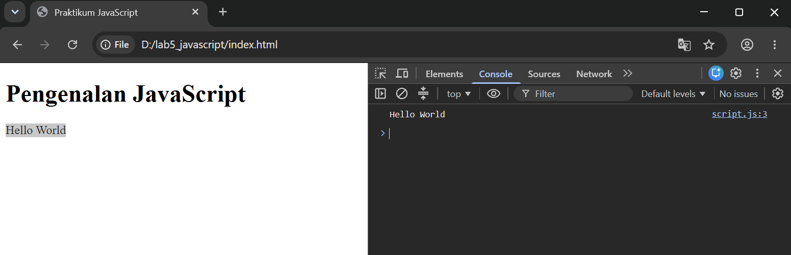  
  
  

### Langkah 2: Alert dan Prompt
Meminta nama lewat `prompt()`, lalu menampilkan sapaan dengan `alert()` dan mengubah teks halaman. Jika input kosong atau Cancel, program menampilkan "Nama belum diisi."

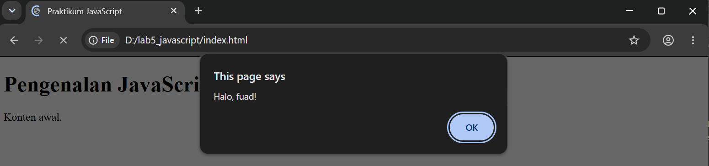  
  
  

### Langkah 3: Function dan Operasi Aritmetika
Membuat function `operasiDasar(a, b)` yang mencetak hasil penjumlahan, pengurangan, perkalian, pembagian, dan modulus ke Console.

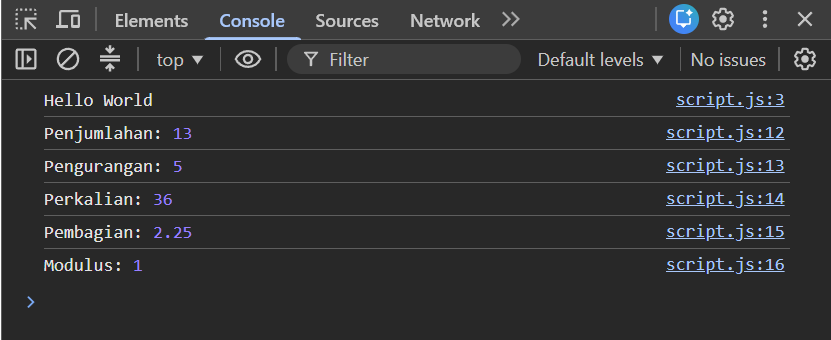  
  

### Langkah 4: Seleksi Kondisi if-else
Meminta nilai lewat `prompt()`, mengonversinya ke `Number`, lalu menentukan "Lulus" (nilai ≥ 60), "Belum lulus", atau "Input nilai tidak valid".

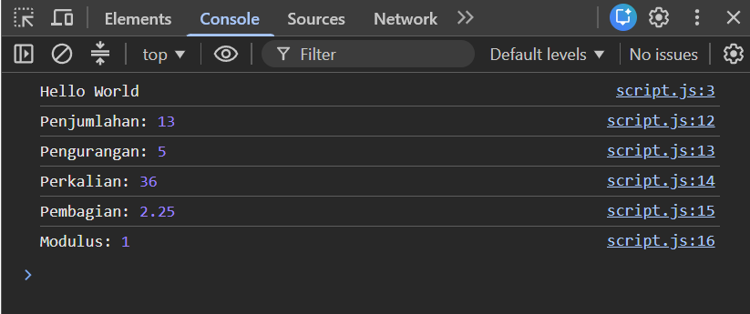  
  
  
   

### Langkah 5: Seleksi Kondisi switch
Meminta angka 1-5 lalu menampilkan nama bilangannya dengan `switch`. Nilai di luar 1-5 ditangani oleh `default`.

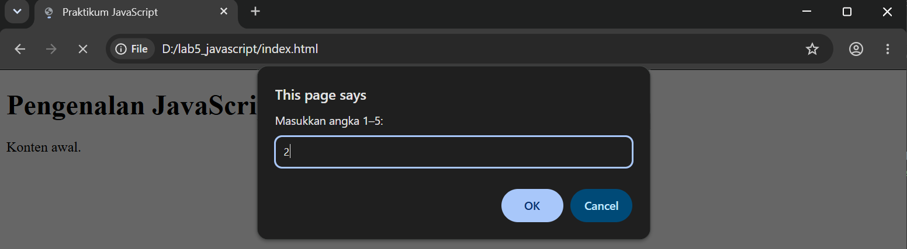  
  
   

### Langkah 6: Form Bilangan Genap atau Ganjil
Menambahkan input angka dan tombol "Periksa". Function `cekBilangan()` membaca nilai input lalu menampilkan "Bilangan genap", "Bilangan ganjil", atau pesan error bila input tidak valid.

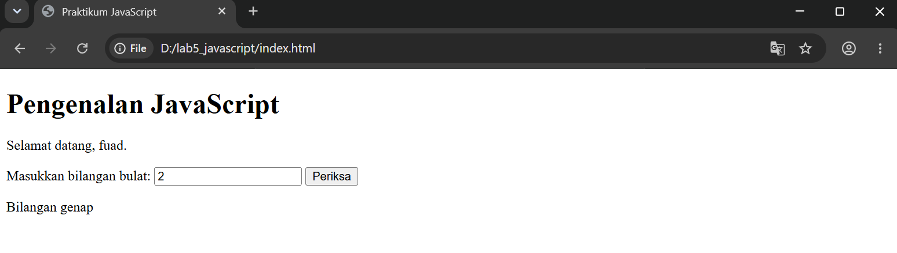  
  
  
  

### Langkah 7: Mengubah Warna Halaman
Membuat tiga tombol (hijau, putih, kuning) yang memanggil satu function `ubahWarnaLatar(warna)` untuk mengubah `backgroundColor` pada `body`.

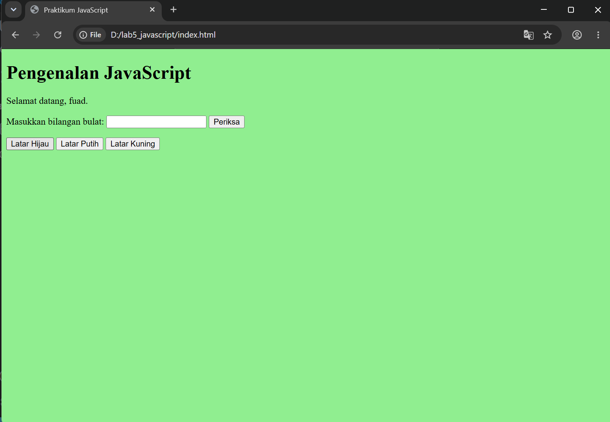  
  
  
  
  

### Langkah 8: DOM dan Checkbox Menu Makanan
Membuat daftar menu dengan checkbox. Event listener `change` memanggil `hitungTotal()` sehingga total harga berubah otomatis saat pilihan dicentang atau dilepas.

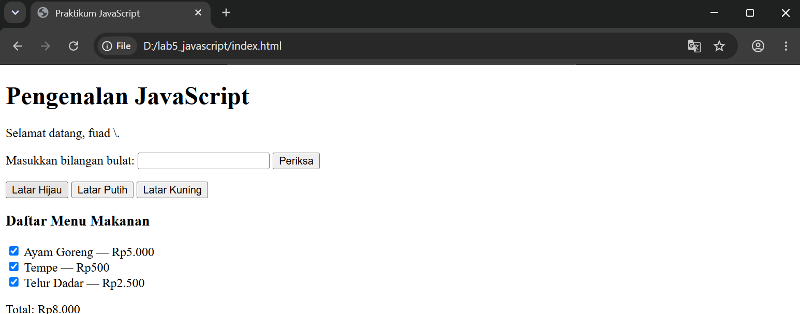  
  
  

## 2. Mini Project: Kalkulator Nilai Mahasiswa

Membuat form input Nilai Tugas, UTS, dan UAS. Nilai akhir dihitung dengan bobot **30% tugas + 30% UTS + 40% UAS**, lalu predikat (A-E) dan status kelulusan (Lulus jika ≥ 60) ditentukan. Perhitungan dipisahkan dalam function `hitungNilaiAkhir()` dan `tentukanPredikat()`, sedangkan `hitungNilai()` mengurus validasi dan tampilan.

**Tahap 1:** form, validasi rentang 0-100, dan hasil di Console. Pengujian di Console: nilai 89/85/88 menghasilkan 87.40 (A, Lulus) dan nilai 30/40/25 menghasilkan 31.00 (E, Belum lulus).

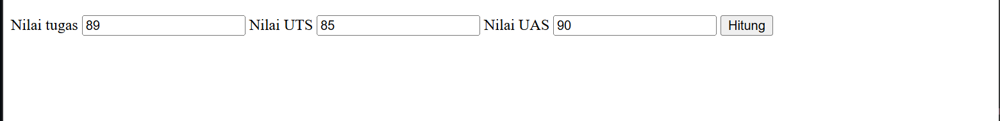  
  
  
  
  
  

**Tahap 2:** validasi ditambah pengecekan input kosong, dan hasil (nilai akhir, predikat, status) ditampilkan pada halaman HTML.

  
  

Skenario pengujian:

| Tugas | UTS | UAS | Nilai Akhir | Predikat | Status |
|-------|-----|-----|-------------|----------|--------|
| 89 | 87 | 99 | 92.40 | A | Lulus |
| 76 | 88 | 46 | 67.60 | C | Lulus |
| 40 | 77 | 50 | 55.10 | D | Belum lulus |

  
  

## 3. Eksperimen Mandiri

### Eksperimen 1: Latihan 3 dengan Input Prompt
Mengubah `operasiDasar()` agar menerima dua angka dari `prompt()` dan mengonversinya ke `Number`. Contoh input 30 dan 29 menghasilkan penjumlahan 59, pengurangan 1, perkalian 870, dan modulus 1.

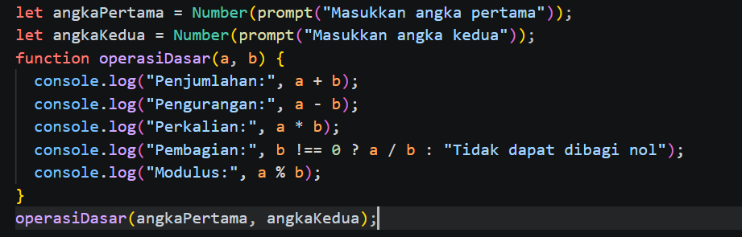  
  
  
  

### Eksperimen 2: Tabel Perkalian 7
Menggunakan perulangan `for` dari 1 sampai 10 untuk mencetak hasil perkalian angka 7 ke Console.

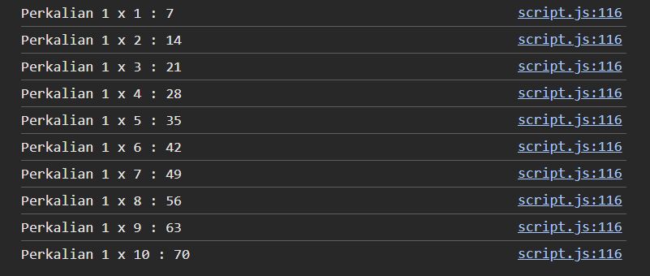  
  

### Eksperimen 3: Function `cekGenap(angka)`
Membuat function `cekGenap(angka)` yang memeriksa genap atau tidaknya sebuah angka dan menampilkan hasil `True` atau `False`. Diuji dengan angka 3 (False) dan 6 (True).

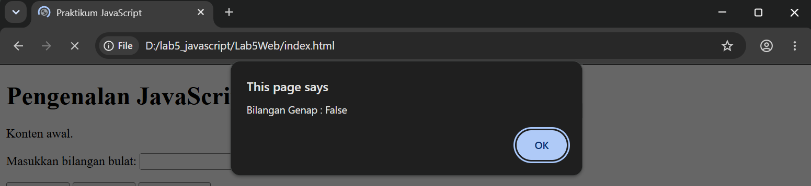  
  
  
  

### Eksperimen 4: Validasi Form Tidak Boleh Kosong
Menambahkan input angka dan tombol Submit yang memanggil `cek()`. Jika kolom kosong, muncul alert "Masukkan bilangan!". Jika terisi, `cekGenap()` dijalankan.

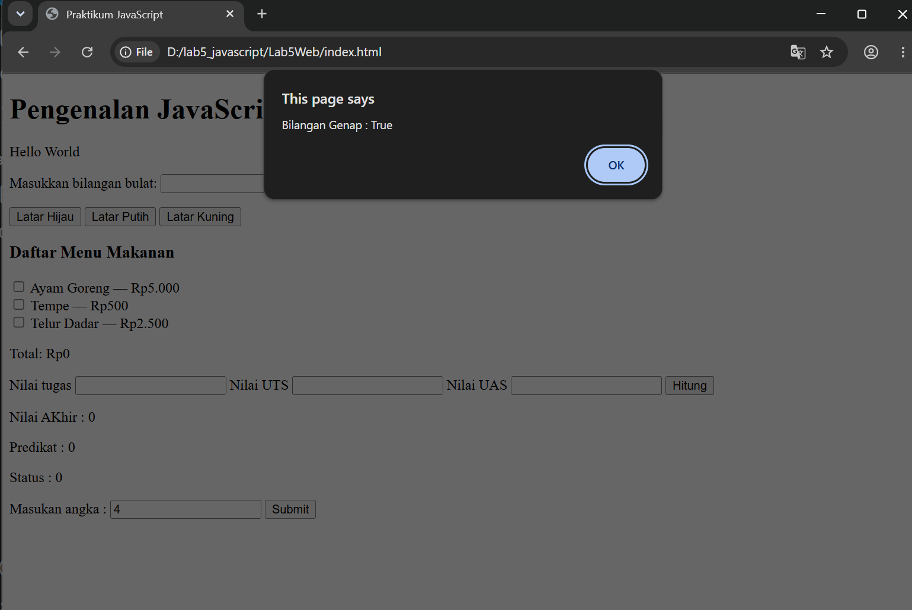  
  
  
  

### Eksperimen 5: Menambah Pilihan Menu dan Harga
Menambahkan tiga menu baru pada Latihan 8: Ayam Goreng (Rp5.000), Tempe (Rp500), dan Telur Dadar (Rp2.500). Total semua menu Rp8.000.

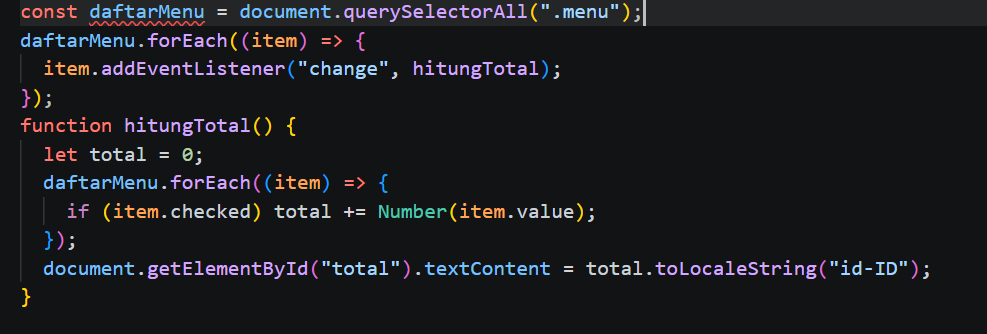  
  
  
  

### Eksperimen 6: Tombol Sembunyikan/Tampilkan Elemen
Membuat tombol yang memanggil `toggle()` untuk mengubah `style.display` pada kotak `#kotak` antara `block` dan `none`.

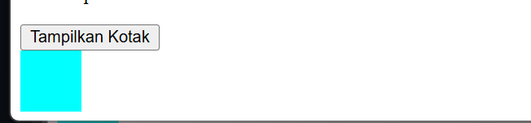

